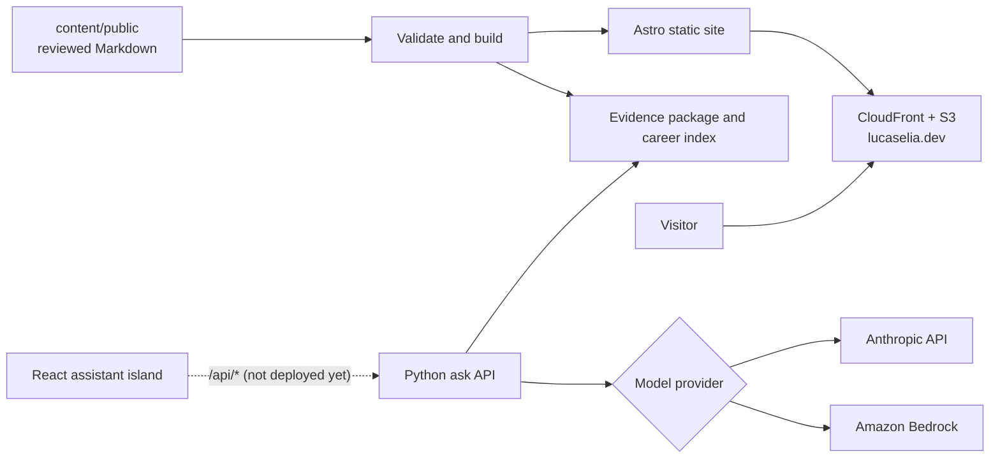

# Career Portfolio

**Live site: [lucaselia.dev](https://lucaselia.dev)**

This is the source for my career portfolio. The site is a static record of my roles and education, built from reviewed Markdown. Alongside it is a career assistant that answers questions about that record, cites the page section behind each answer, and declines when the record does not cover the question.

## What it demonstrates

- **Grounded answers with citations and refusals.** The assistant answers only from approved public sections. Every answer ends with a hidden `SOURCES:` line, and citations are checked against the evidence package before they reach the page. Questions the pages do not cover get one fixed refusal sentence. A partial question gets the supported part and a short statement of the gap.
- **A provider interface.** `ask_api.model_providers` defines one request type, one stream-event type, and a `ModelProvider` protocol. The Anthropic API and Amazon Bedrock are interchangeable behind it, and a test runs the same conversation through both and requires identical events ([ADR-008](docs/adr/008-anthropic-api-for-model-answers.md)).
- **A CDK site stack with a strict CSP.** `PortfolioSiteStack` serves the site from a private S3 bucket through CloudFront with Origin Access Control, ACM, and Route 53. The Content-Security-Policy starts from `default-src 'none'`, allows scripts only from the site plus Astro's two inline island scripts by exact hash, and fetches only from the site. A build check and a browser test fail if the built HTML and the policy ever disagree ([ADR-007](docs/adr/007-static-site-hosting.md), [ADR-009](docs/adr/009-production-assistant.md)).
- **A test suite.** Vitest, Pytest, and Playwright with axe cover content validation, citation routes, the answer pipeline, both model providers (with the real SDKs over mocked transports), the synthesized CloudFormation, and accessibility. No test calls AWS or a paid model.
- **An evaluation with hallucination probes.** [tests/evaluation](tests/evaluation/README.md) holds route expectations and the recorded live runs. The probes include an off-topic question and a fictional project, Lumen Harbor, that is public on the site but excluded from the assistant's evidence. The assistant must refuse both.

## Status

| Part                 | State                                                                                                                                                                               |
| -------------------- | ----------------------------------------------------------------------------------------------------------------------------------------------------------------------------------- |
| Static site          | Live at [lucaselia.dev](https://lucaselia.dev).                                                                                                                                     |
| Assistant            | Runs on the live site and locally. Live local evaluations on Claude Haiku 4.5 are recorded.                                                                                         |
| Production assistant | Live on the site: a streaming Lambda function URL behind CloudFront `/api/*` with OAC and WAF ([ADR-009](docs/adr/009-production-assistant.md)). The production evaluation is next. |
| CI                   | GitHub Actions runs format, lint, type, test, content, build, synth, and public-safety checks. It never deploys.                                                                    |

The plan is in the [roadmap](docs/roadmap.md).

## Architecture



- `apps/web`: Astro with static output. React is used only for the assistant island.
- `services/ask-api`: the Python 3.13 production app for `POST /api/ask` (run behind the Lambda Web Adapter), the local development server, and the model providers.
- `infrastructure`: one CDK app with two stacks in `us-east-1`: `PortfolioAssistantStack` (the ask function) and `PortfolioSiteStack` (the site, CloudFront, WAF, and the `/api/*` route to the function).
- `content/public`: the reviewed Markdown that the site, the career index, and the evidence package are all built from.

The full picture is in [system design](docs/system-design.md). Decisions are in the [ADR index](docs/adr/README.md), and how the design evolved is in [design history](docs/design-history.md).

## How this was built

- **Architecture and specs:** written by me. That covers the product spec, the ADRs, the roadmap, and the guardrails.
- **Implementation:** done by Claude Code, working under the rules in [CLAUDE.md](CLAUDE.md) and [.claude/settings.json](.claude/settings.json). Those rules deny AWS, CDK, deploy, model-mode, publish, and git-write commands, and keep credentials and private notes out of reach.
- **Review and planning:** done in a separate Claude chat. It reviewed each round with me and wrote the next scoped prompt.
- **Live evaluations and every deploy:** run by me, from my own terminal.

## Local development

Prerequisites: Node.js 24, pnpm 12.7.0, and uv 0.12.x. uv installs Python 3.13 for the backend.

```bash
pnpm install
uv sync --directory services/ask-api
```

| Command                    | What it does                                                                                                                              |
| -------------------------- | ----------------------------------------------------------------------------------------------------------------------------------------- |
| `pnpm dev:api`             | Build the career index and start the local ask server on `127.0.0.1:8787`.                                                                |
| `pnpm dev:web`             | Start the site on `127.0.0.1:4321`, pointed at the local ask server.                                                                      |
| `pnpm dev:api:prod`        | Run the production ask app as Lambda runs it, on `127.0.0.1:8080/api/ask`, with the fixture provider.                                     |
| `pnpm build:site`          | Build the production site (with the assistant on `/api/ask`, no fixture) into `apps/web/dist`.                                            |
| `pnpm format:check`        | Check formatting (Prettier and Ruff).                                                                                                     |
| `pnpm lint`                | Lint TypeScript (ESLint) and Python (Ruff).                                                                                               |
| `pnpm typecheck`           | Type-check the web app, CDK, scripts, and Python (pyright).                                                                               |
| `pnpm test`                | Run Vitest and Pytest.                                                                                                                    |
| `pnpm test:browser`        | Run Playwright and axe against the development and production builds.                                                                     |
| `pnpm check:public`        | Scan the files that would be published for account IDs, home paths, internal hosts, and keys.                                             |
| `pnpm synth`               | Build the production site and synthesize both stacks offline, with a placeholder hosted zone id and a stub adapter layer. Not deployable. |
| `pnpm prepare:web-adapter` | Fetch and verify the pinned Lambda Web Adapter binary for the function's layer. Run before diff or deploy; CI uses `--stub`.              |

Model mode is opt-in and makes paid calls:

- `pnpm dev:api:model` with `pnpm dev:web:model` streams answers from the Anthropic API. The key comes from a macOS Keychain item, named by `ANTHROPIC_KEYCHAIN_ITEM`, for that process only.
- `LOCAL_AWS_PROFILE=<profile> pnpm dev:api:model:bedrock` uses Bedrock instead.
- `LOCAL_MODEL_CONVERSATION=fixture` streams a labeled fixture and calls no model.
- `pnpm dev:api:prod:model` runs the production app with the Keychain key instead of the fixture.

Watch the production app stream (fixture mode):

```bash
curl -N -X POST http://127.0.0.1:8080/api/ask \
  -H 'Content-Type: application/json' -H 'Accept: application/x-ndjson' \
  -d '{"question":"How did Lucas improve production reliability?","mode":"career_question"}'
```

Content rules (front matter schema, visibility, and the assistant flag) are in [content/README.md](content/README.md).

## Repository layout

```text
apps/web/            Astro site and the React assistant island
services/ask-api/    Python ask API: production app, local dev server, model providers
infrastructure/      CDK app: the assistant stack and the site stack
content/public/      Reviewed public Markdown
packages/content/    Shared citation routes and heading slugs
schemas/             Public-document JSON Schema and the OpenAPI contract
scripts/             Validation, indexing, evidence build, Lambda staging, adapter fetch, check:public
tests/evaluation/    Evaluation cases and recorded live runs
docs/                System design, roadmap, ADRs, product spec, design history
```

## License

The code is under the [MIT License](LICENSE). The career content is not: the text in `content/public` and other personal career text in this repository is all rights reserved. See [LICENSE](LICENSE) for that split.
