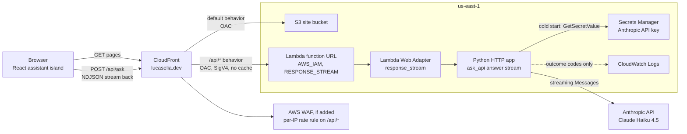
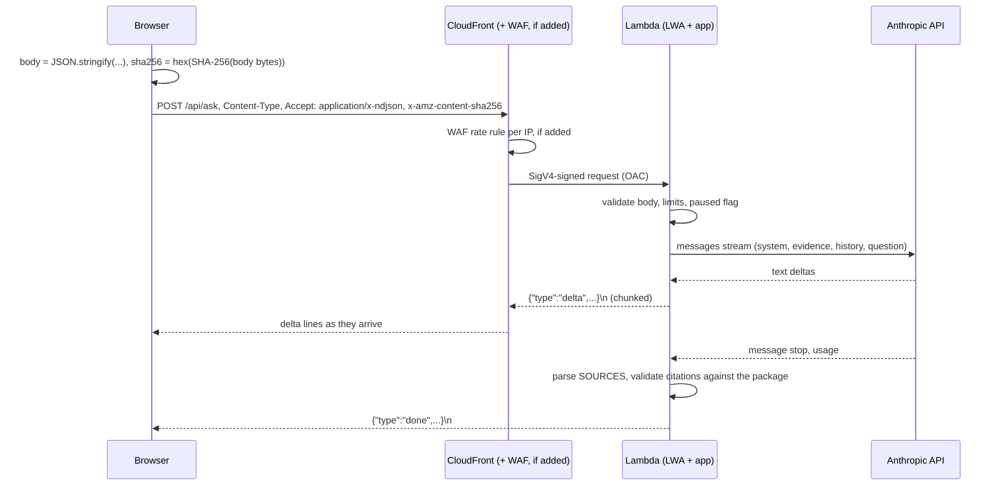

# Production assistant

Decisions locked by the owner on October 17, 2026: the transport, `us-east-1` with a new `PortfolioAssistantStack`, the standard-library server, no reserved concurrency (the account limit of 10 is the cap), a $10 Anthropic workspace limit, a $15 AWS budget alarm created by hand, and the limits below. WAF is not decided; every WAF item here is conditional on it. Round 1 (the production app) is built.

This is the specification for putting the career assistant live on `https://lucaselia.dev` with streamed answers. The decisions and the transport comparison are in [ADR-009](../adr/009-production-assistant.md) (Proposed). The local behavior it carries into production is in [system design](../system-design.md#local-model-conversation) and [ADR-008](../adr/008-anthropic-api-for-model-answers.md).

Nothing here is built or deployed. Prices and limits cite AWS and Anthropic documentation as of October 17, 2026. Claims that could not be verified are marked.

## Goals

- The same answers as local model mode: prompt `local-3`, the full approved evidence package, bounded history, `SOURCES:` validation, the fixed refusal, and the shared `answer_style` rules.
- Text that streams as the model writes it, on desktop and mobile.
- One origin (`lucaselia.dev`), no CORS, and an API that can only be reached through CloudFront.
- Bounded cost: a $10 monthly model cap, a small AWS baseline, and an alarm.
- No logging of questions, answers, prompts, or request bodies, and no transcripts.

## Architecture



Stacks, both in `us-east-1`, in the site CDK app:

| Stack                           | Holds                                                                                                                                                                                                             |
| ------------------------------- | ----------------------------------------------------------------------------------------------------------------------------------------------------------------------------------------------------------------- |
| `PortfolioAssistantStack` (new) | The ask function (Python 3.13, ARM64), its function URL, the Lambda Web Adapter layer built from a pinned binary, the log group, the secret reference (by name), reserved concurrency, and the CloudWatch alarms. |
| `PortfolioSiteStack` (existing) | The S3 bucket, distribution, certificate, and DNS, plus the new `/api/*` behavior, the function-URL OAC, the Lambda permission for this distribution, the origin request policy, and the WAF web ACL.             |

`CareerPortfolioStack` and its HTTP API, Knowledge Base, S3 Vectors, and publisher are removed from the code. They were never deployed.

## Request flow



1. **Body and hash.** The island serializes the body once, encodes it as UTF-8, and hashes those bytes with `crypto.subtle.digest("SHA-256", …)`. It sends the same bytes with `x-amz-content-sha256: <lowercase hex>`. OAC requires the hash for `POST` to a function URL ([OAC for function URLs](https://docs.aws.amazon.com/AmazonCloudFront/latest/DeveloperGuide/private-content-restricting-access-to-lambda.html)). The request is same-origin, so no preflight runs, and `credentials: "omit"` stays.
2. **Edge checks.** If WAF is added, it counts the request against the per-IP rule. CloudFront signs it with SigV4 for the function URL and forwards only `Content-Type`, `Accept`, and `x-amz-content-sha256`.
3. **Function checks.** The function validates the body, applies the limits below, and checks the in-memory paused flag before calling the model.
4. **Streaming.** The answer stream is the local one, with the same deltas, holdback, deadline, and completion. Each event is written and flushed as one NDJSON line.
5. **Outcome logging.** The function logs one line per request: `ask outcome=… status=… input_tokens=… output_tokens=… latency_ms=…`. Nothing else is logged, not even the request id.

### Browser request

```http
POST /api/ask HTTP/1.1
Host: lucaselia.dev
Content-Type: application/json
Accept: application/x-ndjson
x-amz-content-sha256: <64 lowercase hex characters: SHA-256 of the exact body bytes>

{"question":"…","mode":"career_question","history":[{"role":"user","content":"…"},{"role":"assistant","content":"…"}]}
```

## NDJSON contract

The contract is the local one, and the client parser stays as it is. Production drops the development-only fields.

**Response headers on success:** `200`, `Content-Type: application/x-ndjson; charset=utf-8`, `Cache-Control: no-store`.

| Event   | Fields                                                  | Notes                                                                                                                                                                                                                                                                       |
| ------- | ------------------------------------------------------- | --------------------------------------------------------------------------------------------------------------------------------------------------------------------------------------------------------------------------------------------------------------------------- |
| `delta` | `type`, `text`                                          | Visible answer text. The `SOURCES:` line is held back and never sent as a delta.                                                                                                                                                                                            |
| `done`  | `type`, `answer`, `citations[]`, `requestId`, `fixture` | Sent after the `SOURCES:` identifiers are matched to the package. Each citation has `chunkId`, `documentId`, `title`, `section`, and `url`, copied from the package. `fixture` is always `false` in production. **No `usage` or `estimatedCostUsd`.**                       |
| `error` | `type`, `code`, `message`, `requestId`                  | `code` is one of `unavailable`, `validation`, `timeout`, `interrupted`, `cancelled`, or (new) `paused` and `busy`. **No `usage`.** The stream ends after it. A `paused` or `busy` error that happens before any text arrives becomes a 503 or 429 response instead (below). |

Streamed text has not passed the final citation check. A `validation` error after deltas means the answer was discarded, and the UI must replace the partial text, as it does locally.

**Responses before the stream starts** are JSON `{ "message", "requestId", "code"? }`:

| Status | When                                                                                                                                                                 | `code`                              |
| ------ | -------------------------------------------------------------------------------------------------------------------------------------------------------------------- | ----------------------------------- |
| 400    | Invalid JSON, unknown fields, empty question, a question over 500 characters, a mode other than `career_question`, or any route or method other than `POST /api/ask` | —                                   |
| 413    | Body over 16 KB                                                                                                                                                      | —                                   |
| 429    | The model API rate-limited the request (no spend-limit code). If WAF is added, its block action also sends a JSON 429 with `rate_limited`.                           | `busy` (or `rate_limited` from WAF) |
| 503    | Paused after a spend-limit or overload error from the model API (for 5 minutes per environment), or the key, client, or model stream is unavailable                  | `paused` or `unavailable`           |

`GET /ready` answers the adapter's readiness check with `200 {"status":"ready"}`. CloudFront does not route it, so it is not public.

The API never returns 403 or 404 on purpose. The distribution maps those statuses to `/404.html` (ADR-007), so a 403 or 404 reaching the browser means a CloudFront or OAC failure. The client treats it, and any other non-JSON error body, as `unavailable`.

## Limits

| Limit                               | Value                                                         | Where enforced                | Was                  |
| ----------------------------------- | ------------------------------------------------------------- | ----------------------------- | -------------------- |
| Question length                     | 500 characters                                                | Client and function           | 8,000                |
| Request body                        | 16 KB                                                         | Function (and the dev server) | 48 KB (local stream) |
| History                             | 6 exchanges and 12,000 characters, newest kept                | Function (`select_history`)   | 6 and 24,000         |
| History messages in the body        | 20                                                            | Function                      | 20                   |
| `max_tokens`                        | 500                                                           | Function                      | 500                  |
| Temperature                         | 0 (Haiku 4.5)                                                 | Function                      | 0                    |
| Stream deadline                     | 31 s from opening the model stream                            | Function                      | 31 s                 |
| Anthropic client                    | 2 s connect, 31 s read, 1 retry                               | Function                      | Same                 |
| Lambda timeout                      | 35 s                                                          | Lambda                        | 28 s (ADR-005)       |
| Lambda memory                       | 256 MB, reviewed after Round 4                                | Lambda                        | 256 MB               |
| Concurrency                         | No reserved concurrency; the account limit of 10 is the cap   | Lambda account limit          | 5 reserved (ADR-004) |
| CloudFront origin response timeout  | 40 s; connection attempts 1                                   | CloudFront                    | —                    |
| Browser timeout                     | 45 s total                                                    | Client                        | 31 s                 |
| Per-IP rate                         | Not decided; candidate 20 requests per 10 minutes on `/api/*` | WAF, if added                 | —                    |
| Model spend                         | $10 per month (owner-set workspace limit)                     | Anthropic                     | —                    |
| Pause after spend limit or overload | 5 minutes per execution environment                           | Function                      | —                    |

The browser timeout is longer than the server deadline, so the server's own `timeout` event normally arrives first. The extra time covers a cold start.

## Failure modes and UI behavior

| Situation                                                | What the browser receives                                                                                                                                                                  | UI                                                                                                       |
| -------------------------------------------------------- | ------------------------------------------------------------------------------------------------------------------------------------------------------------------------------------------ | -------------------------------------------------------------------------------------------------------- |
| Normal answer                                            | Deltas, then `done`                                                                                                                                                                        | Text streams. Citations appear on `done`. No token or cost line.                                         |
| Unsupported or off-topic question                        | Deltas with the fixed refusal, then `done` with no citations                                                                                                                               | The refusal, with no citations.                                                                          |
| Answer fails citation validation                         | Deltas, then `error` `validation`                                                                                                                                                          | Partial text is replaced by "The answer could not be verified and was discarded." with Retry.            |
| Model or network failure mid-stream                      | Deltas, then `error` `unavailable` or `interrupted`, or the stream closes                                                                                                                  | The partial text is marked incomplete, with the message and Retry.                                       |
| Model slow                                               | `error` `timeout` at 31 s, or the browser aborts at 45 s                                                                                                                                   | "The request timed out. Please try again." with Retry.                                                   |
| Visitor cancels                                          | The client aborts. The function may keep running until its deadline.                                                                                                                       | "The request was cancelled."                                                                             |
| Rate limited by WAF (if added)                           | 429 JSON `rate_limited`                                                                                                                                                                    | "Too many questions in a short time. Please wait a few minutes." No automatic retry.                     |
| Account concurrency limit reached, or the kill switch on | 429 from the function URL, through CloudFront (unverified body)                                                                                                                            | The same busy message.                                                                                   |
| Model spend limit reached, or the model API overloaded   | Before any text: 503 `paused`. Mid-stream: `error` `paused`. Either way the function pauses that environment for 5 minutes, and requests there get 503 `paused` without calling the model. | "The assistant is paused for now. The career pages are still here." The input is disabled for the visit. |
| Model API rate limit (429 without a spend-limit code)    | Before any text: 429 `busy`, after the SDK's one retry. Mid-stream: `error` `busy`. No pause.                                                                                              | "The career assistant is busy. Please try again in a minute." with Retry.                                |
| Secret unreadable at cold start                          | 503 `unavailable`. The read is retried on the next request.                                                                                                                                | The same unavailable message.                                                                            |
| CloudFront or OAC error (403, 404, 502, 504, non-JSON)   | An HTML or empty body                                                                                                                                                                      | The unavailable message. The body is never shown.                                                        |

A spend limit set on an Anthropic workspace returns HTTP 400 with a message starting "You have reached your specified workspace API usage limits". The tier spend cap returns 429 `rate_limit_error` with `error.details.error_code` `enforced_spend_limit_reached` (same source). An overload is a 529 or an `overloaded_error` event mid-stream. The function detects all of these from the SDK's `APIStatusError` (its `error.type`, the message prefix, or `error.details.error_code`), including errors raised while reading the stream, and never logs the message.

The UI keeps the existing loading, streaming, cancel, and retry states and the accessible live-region status.

## Site changes

**CSP**, from `infrastructure/lib/site-headers.ts`:

| Directive     | Now       | Proposed                                                                                                                                                                                                                     |
| ------------- | --------- | ---------------------------------------------------------------------------------------------------------------------------------------------------------------------------------------------------------------------------- |
| `script-src`  | `'none'`  | `'self' 'sha256-…' 'sha256-…'`: the two inline Astro island scripts                                                                                                                                                          |
| `connect-src` | `'none'`  | `'self'`                                                                                                                                                                                                                     |
| All others    | unchanged | unchanged (`default-src 'none'`, `style-src-elem 'self'`, `style-src-attr 'unsafe-inline'`, `font-src 'self'`, `img-src 'self'`, `base-uri`, `form-action`, and `frame-ancestors` all `'none'`, `upgrade-insecure-requests`) |

A production build with the assistant on (checked locally on October 17, 2026) emits two inline scripts, one of 130 bytes and one of 4,380 bytes, identical on all nine pages that render the island. It also emits module files under `/_astro/`. The site synth step computes the hashes from the build, and a test fails if any page contains an inline script whose hash is not in the policy. There is no `'unsafe-inline'` and no `'unsafe-eval'` for scripts. The existing Playwright check of every production page under the exact CSP must pass with the island hydrated.

**Build profile.** `pnpm build:site` sets `PUBLIC_ASK_API_URL=/api/ask` and `PUBLIC_ASK_STREAMING=true`. The production profile still omits Lumen Harbor and `career-index.json`.

**Development-only lines.** The token and cost lines render only outside the production profile. The production function also never sends those fields, so the UI and the API each enforce it.

**Status handling.** The client branches on the HTTP status before it parses: 429 is busy, 503 with `paused` disables the input, any other non-OK status or non-JSON body is unavailable, and 200 with NDJSON is the stream.

## Threat model

| Threat                                                 | Control                                                                                                                                                     | Residual                                                                                                                                |
| ------------------------------------------------------ | ----------------------------------------------------------------------------------------------------------------------------------------------------------- | --------------------------------------------------------------------------------------------------------------------------------------- |
| Direct calls to the function URL, bypassing CloudFront | `AWS_IAM` auth type, and OAC with a resource policy limited to this distribution's ARN                                                                      | None known                                                                                                                              |
| Scripted question floods (cost)                        | Input and history caps, `max_tokens` 500, the $10 workspace spend limit, the 5-minute pause, the account concurrency limit, and a WAF per-IP rule if added  | Without WAF, one client can exhaust the $10 within hours and pause the assistant for the month                                          |
| Request floods (AWS bill)                              | The $15 budget alarm and the kill switch, and WAF blocks at the edge if added                                                                               | Pay-as-you-go CloudFront request fees (and WAF's, if added) are not capped (see cost model)                                             |
| Prompt injection in the question or history            | History is context, never evidence. Citations come only from the package after identifier matching. The model has no tools.                                 | The model may still be talked into off-topic wording. `answer_style` and the fixed refusal limit that, and nothing is logged or stored. |
| Leaking the API key                                    | Secrets Manager, read at cold start by a role allowed only that secret's `GetSecretValue`. Never in environment variables, logs, errors, or the repository. | Anyone who can read the secret in the account                                                                                           |
| Leaking visitor content                                | No body, question, answer, or prompt logging. Outcome codes and token counts only. No storage.                                                              | CloudFront and WAF metrics carry no bodies. Standard logs stay off (ADR-007).                                                           |
| Clickjacking or script injection on the site           | `frame-ancestors 'none'`. `script-src` limited to self and two fixed hashes.                                                                                | —                                                                                                                                       |
| Stale or fabricated citations                          | Citation URLs copied from the bundled package, which deploys with the pages it cites                                                                        | —                                                                                                                                       |

## Cost model

### Unit prices

| Item                       | Price                                                                                                                                                                                                                                                                              | Source                                                                             |
| -------------------------- | ---------------------------------------------------------------------------------------------------------------------------------------------------------------------------------------------------------------------------------------------------------------------------------- | ---------------------------------------------------------------------------------- |
| Claude Haiku 4.5           | $1 per million input tokens, $5 per million output tokens                                                                                                                                                                                                                          | [Pricing](https://platform.claude.com/docs/en/about-claude/pricing)                |
| WAF                        | $5 per web ACL-month, $1 per rule-month, $0.60 per million requests                                                                                                                                                                                                                | [WAF pricing](https://aws.amazon.com/waf/pricing/)                                 |
| CloudFront (pay as you go) | 10 million HTTPS requests and 1 TB free per month, then $0.0100 per 10,000 HTTPS requests in the US                                                                                                                                                                                | [CloudFront pricing](https://aws.amazon.com/cloudfront/pricing/pay-as-you-go/)     |
| Lambda                     | $0.20 per million requests. The free tier is 1 million requests and 400,000 GB-seconds a month. ARM duration is $0.0000133334 per GB-second (secondary sources; unverified on the AWS page). Streaming past 6 MB per response is $0.008 per GB, which these responses never reach. | [Lambda pricing](https://aws.amazon.com/lambda/pricing/)                           |
| Secrets Manager            | $0.40 per secret-month, $0.05 per 10,000 calls                                                                                                                                                                                                                                     | [Secrets Manager pricing](https://aws.amazon.com/secrets-manager/pricing/)         |
| AWS Budgets                | Free (first two action-enabled budgets also free)                                                                                                                                                                                                                                  | [Budgets pricing](https://aws.amazon.com/aws-cost-management/aws-budgets/pricing/) |

### Per request (model)

- **Typical.** The live evaluation averaged about 2,800 input and 80 output tokens per question, about $0.0032.
- **Worst case within the limits.** About 2,800 base tokens, plus about 3,000 for 12,000 characters of history, plus about 125 for a 500-character question, gives about 6,000 input tokens. Add 500 output tokens: about $0.006 + $0.0025 ≈ $0.0085. Token counts use about 4 characters per token.

The $10 cap covers about 3,000 typical questions, or about 1,100 at the worst case.

### Monthly

| Scenario                                            | Anthropic         | AWS                                                          | Notes                                                                                                                                                                                                                                                                                                         |
| --------------------------------------------------- | ----------------- | ------------------------------------------------------------ | ------------------------------------------------------------------------------------------------------------------------------------------------------------------------------------------------------------------------------------------------------------------------------------------------------------- |
| Normal (about 300 questions)                        | about $1          | about $0.60 without WAF; about $7.60 with WAF                | Secrets Manager $0.40, alarms about $0.20, plus WAF $6 if added. Lambda, CloudFront, and request fees stay inside free tiers.                                                                                                                                                                                 |
| One persistent abuser                               | $10 (cap reached) | about $0.60 (or $7.60 with WAF)                              | Without a per-IP limit, one client can send requests as fast as the 10 concurrent executions allow, and reach the cap in hours. With the candidate WAF rule, one IP sends at most 2,880 a day, which still reaches the cap in under a day at worst-case size. The assistant is paused until the month resets. |
| Distributed abuse, saturating concurrency all month | $10 (cap reached) | up to about $81 Lambda + request fees, plus the baseline     | 10 concurrent executions (the account limit) × 30 days × 256 MB ≈ 6.5 million GB-seconds, about $81 after the free tier. After the cap, the pause makes each request fast, so request count, not duration, dominates. The $15 budget alarm fires long before that; the response is the kill switch.           |
| Request flood (L7)                                  | $10 at most       | baseline + about $1.00 per million requests ($1.60 with WAF) | CloudFront at $1.00 per million, plus WAF at $0.60 per million if added. Blocked requests are still billed on pay-as-you-go. **Not capped.** The budget alarm detects it, and the response is the kill switch.                                                                                                |

The flat-rate CloudFront plans have no overage charges, and requests blocked by WAF never count toward their allowance. The Free plan includes 1 million requests, WAF with 5 rules, and IP rate limiting ([flat-rate plans](https://docs.aws.amazon.com/AmazonCloudFront/latest/DeveloperGuide/flat-rate-pricing-plan.html)). If the Free plan accepts this distribution, it removes both the $6 WAF baseline and the flood exposure. Whether it does is open, because its feature table lists custom response header rules, which the site's CSP uses, only on the Business tier.

### Budget alarm

The AWS Budget is $15 a month, created by the owner by hand, not in the stack. It sends email at 50%, 80%, and 100% of actual spend and at 100% of forecast. It covers AWS only. The Anthropic cap is the separate model limit.

## Observability without content

- **Function logs.** One line per request: `ask outcome=… status=… input_tokens=… output_tokens=… latency_ms=…`. Outcomes are `done`, `error_<code>`, `disconnected`, `invalid`, `unsupported`, `too_large`, `paused`, `busy`, or `unavailable`. Setup failures log `ask setup_error error=<class name>` only. Log retention is 30 days.
- **Metrics and alarms.** Lambda `Invocations`, `Throttles`, `Errors`, and `Duration`, with an alarm when invocations exceed an hourly threshold and an alarm on any throttles. If WAF is added, its blocked-request metrics come from the web ACL.
- **No access logs.** No CloudFront standard or real-time logs (ADR-007), and no WAF full logging, because those would record request details.

## Implementation plan

Each round is reviewed before the next starts. Rounds 1 to 3 make no AWS calls and no paid calls. Tests use injected clients.

### Round 1: production HTTP app (Python only), done

- **Built.**
  - `ask_api.production_app`: a standard-library HTTP server for the Web Adapter, with `POST /api/ask` and `GET /ready`.
  - `ask_api.stream_http`: the HTTP pieces it shares with `dev_server.py`, including stream request parsing and limits, JSON error replies, NDJSON framing, chunked writing, outcome reporting, and removal of development-only fields.
  - `ask_api.ask_request`: request validation, moved out of the exact-answer handler.
  - `ask_api.secret_key`: the Secrets Manager key, read once and cached, or the Keychain key outside Lambda.
  - Spend-limit and overload classification in the Anthropic provider, `paused` and `busy` events in the shared answer stream, and the history cap lowered to 12,000 characters.
- **Packaging.** `anthropic` is a runtime dependency. The Lambda asset now contains the production app, the provider modules, the SDK, and the evidence package at `ask_api/data/evidence/`. `pnpm prepare:api` builds the retrieval artifacts before staging.
- **Local run.**
  - `pnpm dev:api:prod` serves the production app on `127.0.0.1:8080` with the fixture provider, paced so the stream is visible.
  - `pnpm dev:api:prod:model` is the owner-run variant with the Keychain key. It makes paid calls.
- **Tests.** Python:
  - Streaming over a real loopback socket, with the first delta read before the provider is allowed to finish.
  - Every status (200, 400, 413, 429, 503), limit enforcement, and the pause and its expiry, including a pause mid-stream.
  - Secret caching and failure without echo, and the Lambda refusal of an environment key.
  - The log line's exact content, and the absence of question, answer, history, and request id.
  - Client disconnect closing the model stream.
  - Real-SDK classification of spend-limit, tier-cap, overload, and rate-limit errors.
- **Tests.** Scripts: staging of the SDK and evidence, and refusal without evidence.

### Round 2: infrastructure (synth only)

- **Scope.**
  - `PortfolioAssistantStack` in `us-east-1`: function, URL (`AWS_IAM`, `RESPONSE_STREAM`), adapter layer from a pinned and checksummed binary (`AWS_LWA_INVOKE_MODE=response_stream`, `AWS_LWA_READINESS_CHECK_PATH=/ready`, `ASK_PROVIDER=anthropic`, `ANTHROPIC_SECRET_NAME`), no reserved concurrency, log retention, the secret by name from deploy context, and alarms.
  - Confirm from AWS documentation that reserved concurrency 0, the kill switch, is accepted at an account concurrency limit of 10.
  - In `PortfolioSiteStack`: the `/api/*` behavior (OAC, `CachingDisabled`, all methods, a custom origin request policy with no cookies, response timeout 40 s, connection attempts 1, no viewer function), and the Lambda permission for the distribution. Add the WAF web ACL only if the owner decides on it.
  - Remove `CareerPortfolioStack`, the HTTP API, the Bedrock grounding resources, and `retrieval_publisher`, and move the CI synth to the site app.
  - Status notes on ADR-004 to ADR-008.
- **Acceptance.**
  - `pnpm synth:site`-equivalent synthesis succeeds in tests with placeholder context.
  - `pnpm test` and `pnpm check:public` pass.
  - No account id, ARN with an account, or secret value appears in tracked files or the template.
- **Tests.** CDK assertions for:
  - The function URL auth type and invoke mode, and no public invoke permission.
  - The OAC and permission `SourceArn`.
  - Behavior order and settings, and the origin request policy (no cookies, no `Host`).
  - No reserved concurrency on the function.
  - If WAF is added: the rule scope, limit, and window.
  - The secret read policy limited to one secret name pattern.
  - Retention and alarms.
  - That the site app still cannot synthesize anything else.

### Round 3: site

- **Scope.**
  - CSP hashes computed from the build, and `connect-src 'self'`.
  - The production profile with the assistant on.
  - Body hashing and the `x-amz-content-sha256` header.
  - Status-aware error handling and the paused state.
  - Token and cost lines only in development.
  - The 500-character question limit and the 45 s timeout.
- **Acceptance.**
  - `pnpm test`, `pnpm test:browser`, and `pnpm build:site` pass.
  - The production build has no inline script outside the two hashed ones.
- **Tests.**
  - Unit tests for hashing (the digest of the exact sent bytes) and for every row of the failure table.
  - Playwright tests against the production preview under the exact CSP, with routed fake NDJSON streams: progressive deltas, `done` with citations, `validation` after deltas, 429, 503 `paused`, and a non-JSON 502.
  - Mobile viewport and axe.

### Round 4: deployment and smoke test (user-run)

- **Scope.** Claude prepares the exact commands and a checklist. The owner runs every step.
- **Acceptance.**
  - The function URL called directly is refused.
  - `/api/ask` streams progressively through CloudFront: deltas arrive over time, observed with a streaming client and in the browser.
  - If WAF is added, exceeding its limit gives the JSON 429.
  - The kill switch drill (reserved concurrency 0, then restored) shows the busy message, then recovers.
  - CSP shows no violations in the browser console.
  - The cold-start init duration and first-byte time are recorded.
- **Tests.** The smoke checklist, recorded in the handoff without question text.

### Round 5: production evaluation (user-run)

- **Scope.** The seven questions from the [live local evaluation](../../tests/evaluation/README.md#live-local-evaluation), asked on the live site on desktop and mobile: current role, production reliability, the tools follow-up, degree, AWS start date, an unsupported question, and Lumen Harbor.
- **Acceptance.**
  - The same outcomes as the local recheck: grounded answers with citations, the partial-support follow-up, the plain "no", and the fixed refusal for the unsupported and Lumen Harbor questions.
  - Text streams progressively, and the `SOURCES:` line never shows.
  - No token or cost line appears.
- **Records.** Outcomes go in `tests/evaluation/README.md` without question text. Token counts and cost come from the Anthropic Console usage page, not the UI. Then ADR-009 becomes Accepted and the Slice 2 gate closes.

## User-run steps, in order

Exact commands are written in Rounds 2 and 4. Claude does not run any of these.

1. **Decide WAF**, the remaining open item below.
2. **Anthropic Console.**
   - Create a dedicated workspace for the portfolio, because the default workspace cannot have limits ([workspace limits](https://platform.claude.com/docs/en/api/rate-limits#setting-lower-limits-for-workspaces)).
   - Set its monthly spend limit to $10.
   - Create an API key in that workspace.
3. **Lambda concurrency.** The account limit is 10, so the function has no reserved concurrency ([reserved concurrency](https://docs.aws.amazon.com/lambda/latest/dg/configuration-concurrency.html)). Nothing to request unless the kill switch turns out not to be allowed (Round 2 checks).
4. **Secret.** Create the secret in Secrets Manager in `us-east-1` from the console (not the shell), and paste the key. Keep only the secret's name for the deploy context.
5. **AWS Budget.** Create a $15 monthly budget by hand, with email alerts at 50%, 80%, and 100% actual and 100% forecast. It is not in the stack.
6. **Bootstrap.** Confirm CDK bootstrap in `us-east-1` exists. It does already, for the site.
7. **Build and deploy.**
   - Run `pnpm build:site`.
   - Deploy both stacks with the existing deploy profile, passing the hosted zone id and the secret name as context. One command for both stacks, assistant first.
8. **Smoke test.** Run the Round 4 checklist, including the kill switch drill.
9. **Evaluate.** Run the Round 5 production evaluation.
10. **Ongoing.**
    - Review the AWS and Anthropic usage pages monthly.
    - On a budget alert, use the kill switch (reserved concurrency 0) first, then investigate.

## Open questions for the owner

- **Rate limiting.** Pay-as-you-go WAF at about $6 a month, the flat-rate Free plan if it accepts the CSP headers policy, or no WAF, relying on the spend cap, the pause, the account concurrency limit, and the budget alarm?
- **Per-IP limit**, if WAF is added: 20 requests per 10 minutes?

Decided on October 17, 2026: the transport, `us-east-1` with a separate `PortfolioAssistantStack`, the standard-library server, no reserved concurrency, the limits, and the budgets (a $10 Anthropic workspace limit and a $15 AWS budget created by hand).
