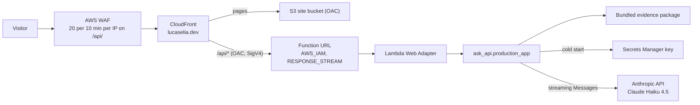

# System design

This document describes the career portfolio as it exists in the repository today. It is the current integrated picture. Architectural choices stay in the [ADR index](adr/README.md). Planned work stays in the [roadmap](roadmap.md). How the design got here is in [design history](design-history.md).

The static site is live at `https://lucaselia.dev` on S3 and CloudFront, without the assistant ([ADR-007](adr/007-static-site-hosting.md)). The production assistant ([ADR-009](adr/009-production-assistant.md), Proposed) is built and synthesized but not deployed: a streaming Lambda function URL behind the same CloudFront distribution at `/api/*`. The production build (`pnpm build:site`) includes the assistant, which posts to `/api/ask`; the next deploy turns it on.

## Purpose and audience

The product is a public career portfolio and a career-question assistant for Lucas Elia.

Intended visitors are hiring managers, recruiters, engineers, and professional contacts. They should be able to read a reviewed public record and ask questions about that record.

The public corpus is reviewed Markdown in `content/public`. It is separate from the author’s private career notes. This repository does not read them, and no command here queries them.

## Goals

- Present reviewed career information as a conventional portfolio.
- Answer career questions with a model that writes from the approved public evidence only, and stream the answer as it is written.
- Cite stable public page sections.
- Keep operating cost and infrastructure complexity low.
- Demonstrate backend, cloud, infrastructure, testing, and agentic-development practices.

## Non-goals

- A general-purpose chatbot.
- Access to private career notes.
- Authentication or saved visitor conversations.
- Job comparison. The local JSON handler accepts `mode: job_comparison` and returns a fixed not-implemented sentence; the production app refuses it.
- User uploads, an administrative web UI, model training or fine-tuning, autonomous agents, and multi-region infrastructure.

## Current architecture

The site is an Astro static build. React is limited to the assistant island in `apps/web` ([ADR-001](adr/001-astro-react-island.md)). The ask service is Python in `services/ask-api`. Infrastructure is one TypeScript CDK app, `infrastructure/bin/site.ts`, with two stacks in `us-east-1`:

- `PortfolioAssistantStack`: the ask function (Python 3.13, ARM64) running `ask_api.production_app` behind the AWS Lambda Web Adapter, its IAM-authenticated function URL in `RESPONSE_STREAM` mode, the adapter layer built from a pinned binary, and a 14-day log group.
- `PortfolioSiteStack`: the private S3 bucket, the CloudFront distribution with OAC, the certificate and DNS, a WAF web ACL, and the `/api/*` behavior that sends the ask API to the function URL through a Lambda OAC.

Only the visitor-to-site path is deployed. Locally, `pnpm dev:api` serves the exact-answer JSON handler on `127.0.0.1:8787`, `pnpm dev:api:model` streams model answers through the same answer code the production app uses, and `pnpm dev:api:prod` runs the production app itself on `127.0.0.1:8080` with the fixture provider.

## Build-time content flow

Tracked source is `content/public`, the schemas in `schemas/`, and the generators in `scripts/` and `packages/content`. Generated artifacts are gitignored and rebuilt by these commands.

1. `pnpm validate:content` checks `content/public` against `schemas/public-document.schema.json` and the safety rules. Drafts validate and are not published.
2. The Astro build writes static pages at the citation routes `/profile/{id}`, `/experience/{id}`, `/background/{id}`, and `/work/{id}`, with H2 anchors.
3. `pnpm index:content` writes `generated/career-index.json`; `pnpm sync:content` copies it to the site and to the Python package ([ADR-003](adr/003-bundle-career-index-with-lambda.md)).
4. `pnpm build:retrieval` writes the evidence package: one `.txt` file and one `.txt.metadata.json` sidecar per assistant-retrievable H2 section, plus `generated/retrieval-manifest.json`. Each text file has title, type, summary, and section lines, a `Facts:` block of labeled front matter, then the section body. Documents with `assistant_retrievable: false`, including `fictional-lumen-harbor.md`, stay out.
5. `pnpm prepare:api` validates, indexes, synchronizes, builds the evidence package, and stages `infrastructure/asset/ask-api`: the `ask_api` package (with the career index and evidence package under `ask_api/data/`), `run.sh` at the root, and the runtime dependencies pinned in `services/ask-api/uv.lock`. boto3 is not staged; the Python 3.13 runtime provides it ([ADR-009](adr/009-production-assistant.md)).
6. `pnpm prepare:web-adapter` writes `infrastructure/asset/web-adapter-layer`: the Lambda Web Adapter binary, read anonymously from its public image (with retries) and checked against a pinned manifest digest, layer digests, and binary SHA-256, plus the layer's `bootstrap`. `--stub` writes a non-deployable placeholder for offline CI synthesis; the site app accepts it only with `-c webAdapterStub=allow`.

The current public corpus is the profile, five experience documents, two education documents, and the fictional Lumen Harbor project. Eight real documents are assistant-retrievable.

## Runtime request flow

The production contract is in [production assistant](design/production-assistant.md#ndjson-contract). In short:

1. The browser posts `{ question, mode: "career_question", history }` to `/api/ask` with `Accept: application/x-ndjson` and the body's SHA-256 in `x-amz-content-sha256` (OAC requires it for `POST` to a function URL).
2. WAF counts the request per IP. CloudFront signs it with SigV4 and forwards only `Content-Type` and `Accept` through the origin request policy (CloudFront does not allow `x-amz-content-sha256` there).
3. The production app validates the body (question up to 500 characters, body up to 16 KB), checks its pause flag, and streams the answer: `delta` events as the model writes, then `done` with citations matched to the evidence package, or `error`.
4. Statuses are 200, 400, 413, 429, and 503 only. A spend-limit or overload error pauses that environment for 5 minutes. Responses never carry token counts or cost.

The local exact-answer handler (`ask_api.handler`, the development server's default JSON path) answers from the packaged career index by phrase match, and returns “I don't have anything on that in Lucas's career pages. You can ask about his roles at AWS, what he's worked on, or his education.” for anything else. It calls no model.

## IAM and trust boundaries

| Boundary                       | What it can do                                                                                                                                                | What it is not                                               |
| ------------------------------ | ------------------------------------------------------------------------------------------------------------------------------------------------------------- | ------------------------------------------------------------ |
| Public visitor                 | Reach the site and `/api/*` through CloudFront, subject to WAF.                                                                                               | Not an AWS principal. Cannot call the function URL directly. |
| CloudFront (this distribution) | `lambda:InvokeFunctionUrl` and `lambda:InvokeFunction` on the ask function, with `aws:SourceArn` set to this distribution; `s3:GetObject` on the site bucket. | Not usable by another distribution.                          |
| Ask function role              | Write its own logs; `secretsmanager:GetSecretValue` and `DescribeSecret` on the one named secret.                                                             | No other AWS access.                                         |
| Deploy identity                | The owner's MFA profile runs CDK.                                                                                                                             | Claude does not deploy. No CI deployment role exists.        |

## Reliability and security controls

- Public documents fail validation when schema, references, citation anchors, internal URL patterns, phone numbers, or street addresses are unsafe.
- Citation URLs come from the evidence package after identifier matching. The model cannot supply one.
- The function URL accepts only SigV4-signed calls from this distribution.
- Limits: 500-character questions, 12,000 characters of history, 16 KB bodies, `max_tokens` 500, a 31-second stream deadline, a 35-second Lambda timeout, a 40-second CloudFront origin read timeout, and WAF's 20 requests per 10 minutes per IP.
- No reserved concurrency; the account's concurrency limit caps the function. The kill switch is reserved concurrency 0 ([runbook](design/production-assistant.md#runbook)).
- The Anthropic key is read from Secrets Manager at cold start and is never logged or returned.
- Logs: one line per request with request id, outcome, status, token counts, and latency. No question, answer, prompt, history, body, IP, or key. WAF sampled requests are off. CloudFront access logs are off.
- The site's CSP allows scripts only from the site plus Astro's two inline island scripts by hash, one inline island style by hash, and fetches only to the site. The site build check and a build test fail if the built pages and the pinned hashes disagree.
- The repository contains no credentials or account identifiers; `pnpm check:public` scans every file that would be committed.

## Testing strategy

- `pnpm validate:content` checks the corpus.
- Vitest covers `packages/content`, `apps/web`, `scripts` (including staging and the adapter fetch, against a fake registry), and both CDK stacks (synthesized in-process).
- Pytest covers the exact-answer handler, the answer stream, the providers (including the real Anthropic SDK over a mock transport), the production app over a real loopback socket, and the secret loader.
- `tests/evaluation/cases.json` records route expectations; live model runs are recorded in the [evaluation notes](../tests/evaluation/README.md).
- Unit tests make no AWS or model calls. `pnpm synth` and CI synthesize offline with a placeholder hosted zone id and a stub adapter layer; nothing is fetched or looked up.

## Current deployment state

- `PortfolioSiteStack` is deployed by the owner and live at `https://lucaselia.dev` (without the `/api/*` behavior and WAF, which are synthesized only).
- `PortfolioAssistantStack` has not been deployed.
- The public repository's CI verifies every push and synthesizes both stacks.

## Important tradeoffs

| Tradeoff            | Current choice                                                                              | ADR                                                                                               |
| ------------------- | ------------------------------------------------------------------------------------------- | ------------------------------------------------------------------------------------------------- |
| Evidence            | The full approved evidence package, bundled with the function. No Knowledge Base.           | [ADR-009](adr/009-production-assistant.md)                                                        |
| Transport           | Function URL in `RESPONSE_STREAM` mode with the Lambda Web Adapter, behind CloudFront.      | [ADR-009](adr/009-production-assistant.md)                                                        |
| Model               | Anthropic API, Claude Haiku 4.5 by default; Bedrock stays selectable locally.               | [ADR-008](adr/008-anthropic-api-for-model-answers.md), [ADR-009](adr/009-production-assistant.md) |
| Abuse and cost      | WAF per-IP rate limit, request and output caps, a $10 model spend limit, and a kill switch. | [ADR-009](adr/009-production-assistant.md)                                                        |
| Infrastructure tool | CDK and CloudFormation.                                                                     | [ADR-002](adr/002-github-actions-and-cdk.md)                                                      |
| Site delivery       | Static Astro output and a React island, on S3 and CloudFront.                               | [ADR-001](adr/001-astro-react-island.md), [ADR-007](adr/007-static-site-hosting.md)               |

## Local model conversation

[ADR-006](adr/006-model-conversation-and-streaming.md) is the decision; the same code now backs the production app.

- `pnpm dev:api:model` runs Anthropic mode ([ADR-008](adr/008-anthropic-api-for-model-answers.md)) with the key read from a macOS Keychain item for that one process. The model is `ANTHROPIC_MODEL_ID`, default `claude-haiku-4-5-20251001`. The local server reports token counts and an estimated cost; production never does.
- `pnpm dev:api:model:bedrock` keeps the Nova path with a named `LOCAL_AWS_PROFILE` in `us-west-2`.
- `LOCAL_MODEL_CONVERSATION=fixture` streams an in-process fixture and constructs no model client.
- Providers live in `ask_api.model_providers`: `anthropic_api`, `bedrock`, and `fixture`, with a shared request and event type.

Evidence is the full text, including the `Facts:` block, of every assistant-retrievable section. The loader refuses the package when a section's document is not public and retrievable in the career index, when a section exceeds 20,000 characters, or when the package exceeds 100,000 characters. The last six successful exchanges are sent as context, with older whole exchanges dropped to stay within 12,000 characters. History is not evidence.

Every provider gets `max_tokens` 500 and temperature 0.0 where the model accepts it. The prompt (version `local-3`) carries the shared wording rules in `ask_api/answer_style.py`. When nothing relevant is supported, or the question is off topic, the answer is the fixed sentence above with `SOURCES: none`. The model ends with a `SOURCES:` line, which is never streamed; its chunk identifiers must match the evidence package exactly.

Conversations stay in page memory. The application does not save transcripts or log questions.
