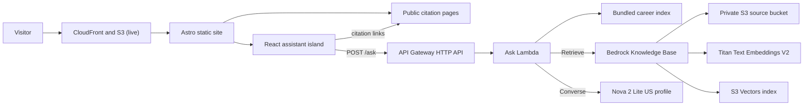
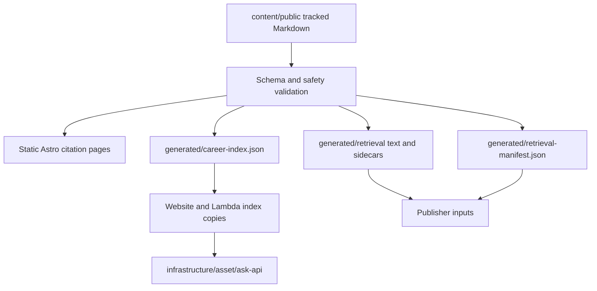
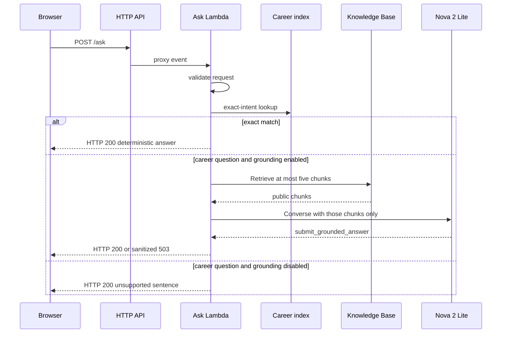

# System design

This document describes the career portfolio as it exists in the repository today. It is the current integrated picture. Architectural choices stay in the [ADR index](adr/README.md). Planned work stays in the [roadmap](roadmap.md). How the design got here is in [design history](design-history.md).

The static site is live at `https://lucaselia.dev` on S3 and CloudFront, without the assistant ([ADR-007](adr/007-static-site-hosting.md)). The assistant runs locally only. The ask API and the grounding resources exist only as synthesized CloudFormation: they have not been bootstrapped, deployed, uploaded, or ingested.

## Purpose and audience

The product is a public career portfolio and a career-question assistant for Lucas Elia.

Intended visitors are hiring managers, recruiters, engineers, and professional contacts. They should be able to read a reviewed public record and ask questions about that record.

The public corpus is reviewed Markdown in `content/public`. It is separate from the author’s private career notes. This repository does not read them, and no command here queries them.

## Goals

- Present reviewed career information as a conventional portfolio.
- Answer career questions from the public index when a supported phrase or index follow-up matches.
- Answer other career questions from grounded public evidence when a grounding provider is configured.
- Cite stable public page sections.
- Keep operating cost and infrastructure complexity low.
- Demonstrate backend, cloud, infrastructure, testing, retrieval, and agentic-development practices.

Model-written answers for ordinary questions, including simple facts, and real response streaming are accepted in [ADR-006](adr/006-model-conversation-and-streaming.md). The local slice is implemented, and the user has run a live local evaluation on the Anthropic API ([ADR-008](adr/008-anthropic-api-for-model-answers.md)). Production streaming is still roadmap Slice 2.

## Non-goals

These remain outside the product:

- A general-purpose chatbot.
- Access to private career notes.
- Authentication or saved visitor conversations.
- Job comparison. The API accepts `mode: job_comparison` and returns a fixed not-implemented sentence.
- User uploads.
- An administrative web UI.
- Model training or fine-tuning.
- Autonomous agents.
- Multi-region active-active infrastructure.

Streaming was a constraint of the first grounded version in [ADR-005](adr/005-grounded-career-answering.md). It is no longer a permanent non-goal. The deployed Lambda contract is still one JSON document. The local development server can stream when both sides opt in. Production streaming remains Slice 2.

## Current architecture

The site is an Astro static build. React is limited to the assistant island in `apps/web`, because that island is the only persistent client-side state. The approved V1 product direction keeps this split and does not add a second frontend framework. The ask API is one API Gateway HTTP API route, `POST /ask`, integrated with one Python 3.13 ARM64 Lambda in `services/ask-api`. Infrastructure is a TypeScript CDK app in `infrastructure`. The application region in that app is `us-west-2`.

The site renders redesign v2 of the portfolio (see [portfolio experience V1](design/portfolio-experience-v1.md)): a hero with one React assistant, a career chart generated from front matter, the reviewed experience and education record, and Contact. Role and education pages carry a position strip and a compact instance of the same assistant. Selected work and a headshot are not built. The production build (`pnpm build:site`) leaves the assistant out. [ADR-001](adr/001-astro-react-island.md) fixes static Astro output and the React island. [ADR-007](adr/007-static-site-hosting.md) hosts the site on S3 and CloudFront in its own CDK app.

Only the visitor-to-site path is deployed. The ask path from `POST /ask` onward is synthesized, not deployed. Local development does not use that AWS path. `pnpm dev:api` serves the same handler on `127.0.0.1:8787`. `pnpm dev:web` points the island at that server. Grounding stays off unless `GROUNDING_ENABLED=true`.

## Build-time content flow

Tracked source is `content/public`, the schemas in `schemas/`, and the generators in `scripts/` and `packages/content`. Generated artifacts are gitignored. They are rebuilt by the commands below.

1. `pnpm validate:content` checks `content/public` against `schemas/public-document.schema.json` and the safety rules. Drafts validate and are not published. Public documents render.
2. The Astro build reads `content/public` and writes static pages at the citation routes: `/profile/{id}`, `/experience/{id}`, `/background/{id}`, and `/work/{id}`, with H2 anchors.
3. `pnpm index:content` writes `generated/career-index.json`. `pnpm sync:content` copies those bytes to `apps/web/public/career-index.json` and `services/ask-api/src/ask_api/data/career-index.json`. Both copies are gitignored. [ADR-003](adr/003-bundle-career-index-with-lambda.md) is why the Lambda ships this file.
4. `pnpm build:retrieval` writes one UTF-8 `.txt` file and one `.txt.metadata.json` sidecar per eligible H2 section, plus `generated/retrieval-manifest.json`. Each text file starts with title, type, summary, and section lines, then a `Facts:` block, then the section body. The `Facts:` block is labeled front matter only: employer, role title, start and end dates (`present` when the end date is null), location (omitted when null), and employment type for experience; institution, program, dates, education status, and degree awarded for education; location for the profile; and skills and topics when present. It adds no wording beyond those labels and stored values. The generator version is `2`. Documents with `assistant_retrievable: false`, including `fictional-lumen-harbor.md`, stay out of that output. These files are gitignored. They are not part of the website or the Lambda asset.
5. `pnpm prepare:api` validates, indexes, synchronizes, and stages `infrastructure/asset/ask-api`. The stager copies `ask_api` and installs the production Python dependencies pinned in `services/ask-api/uv.lock`. It does not copy `retrieval_publisher`, retrieval artifacts, tests, or the virtual environment.

The current public corpus is the profile, five experience documents, two education documents, and the fictional Lumen Harbor project. Eight real documents are assistant-retrievable. Lumen Harbor remains public and indexed so the site and exact index can be tested, and it is excluded from retrieval.

## Runtime request flow

`POST /ask` is specified in `schemas/ask-api.openapi.yaml`. The handler accepts a JSON body or an API Gateway HTTP API event. `requestId` is `requestContext.requestId` when API Gateway supplies one, otherwise a new UUIDv4.

The React assistant keeps the visitor’s question and the answer in a transcript. The composer sends with a button or with Enter. Suggested questions appear before the first exchange. The transcript scrolls inside the assistant panel so a longer thread does not push the page content away. A failure leaves the question in the transcript and in the composer, with a retry control. Nothing is written to storage. Reload clears the thread.

The client posts `{ question, mode: "career_question", history }` when earlier turns were answered. `history` holds at most 20 `{ role, content }` messages. The handler validates that array and passes it only to the deterministic index answerer.

Index answers are phrase matches over the packaged career index, written as short prose. The families are current role, employment history, education and degree, technologies in the current role, AWS work described by the public role summaries, the distributed-systems focus named on the profile, and the public career path. A follow-up can use the previous user question to answer another fact already in that index, such as how long the current role has lasted, where it is based, or what the public summary says. A question that names a public employer or role can return that record’s summary. These are templates and lookups. They are not model generation. Prior messages are not treated as career evidence beyond choosing which index fact to read.

The deployed HTTP response is one JSON document: `answer`, `citations`, `suggestedQuestions`, and `requestId`. With model streaming off, the browser shows a pending status and then the complete answer. It does not reveal a finished answer one character at a time.

When the browser sends `Accept: application/x-ndjson` and `LOCAL_MODEL_CONVERSATION` is `true` or `fixture`, the local server returns newline-delimited events: `delta`, `done`, and `error`. That response is development-only. The Lambda handler does not emit it. `delta` text can appear before `done`. Citations are attached only on `done`, and only after each chunk id exists in the evidence package. The citation URL, title, and section come from that package. Matching an identifier does not prove that every sentence is supported. If validation fails, the event is `error`, the partial answer is removed, and the turn is not added to later history.

When the question does not match the index, grounding is still the ADR-005 path. That path receives the current question only. It does not receive `history`. It calls `Retrieve`, then Converse, requires `submit_grounded_answer`, and validates the complete tool result before any JSON is returned. The local server leaves `GROUNDING_ENABLED` unset, so an unmatched local question returns “I don't have anything on that in Lucas's career pages. You can ask about his roles at AWS, what he's worked on, or his education.” `mode: job_comparison` returns: “Job comparison is not implemented. No model was called and no career material was compared.”

For an unmatched `career_question` when grounding is enabled:

1. Retrieve at most five chunks from the Knowledge Base.
2. Send only those public chunks to Nova 2 Lite through the US inference profile.
3. Require the `submit_grounded_answer` tool. The prompt version is `3`, with the shared wording rules described under Local model conversation.
4. Accept a citation only when its chunk ID was in the retrieval result. Title, section, URL, and document identity come from that trusted chunk.
5. Return “I don't have anything on that in Lucas's career pages. You can ask about his roles at AWS, what he's worked on, or his education.” with HTTP 200 when retrieval succeeds with no chunks, or when generation returns the validated insufficient-evidence sentence.
6. Return HTTP 503, “The career assistant is temporarily unavailable.”, when retrieval, generation, configuration, malformed output, an ungrounded answer, or an unexpected grounding exception fails. The body contains the request ID and no exception text, prompt, retrieved passage, or AWS identifier.

Exact answers still return HTTP 200 when a grounding provider is unavailable. A missing packaged index returns HTTP 500, “The career index is unavailable.”, with the request ID and no filesystem path.

The synthesized Lambda sets `GROUNDING_ENABLED=true`. The local server leaves it unset, so unmatched local questions stay on the unsupported sentence. Open-ended answers have no vectors to read until a future publication and ingestion, which has not been run.

## Publication and ingestion flow

`pnpm publish:retrieval` is the operator command recorded in [ADR-005](adr/005-grounded-career-answering.md). Build, test, synth, and deployment do not run it. Tests inject S3 and Bedrock Agent clients and do not call AWS.

1. Build the deterministic retrieval artifacts.
2. Print a read-only plan. This is the default.
3. Mutate only when `--apply` is present.
4. Upload changed `retrieval/<filename>.txt` objects and their `.txt.metadata.json` sidecars. The manifest stays local.
5. Delete a stale object only when the previous valid publisher state recorded it as managed.
6. Refuse `--apply` when a remote object under `retrieval/` is neither desired nor previously managed. There is no override flag.
7. Start one ingestion job with a new UUIDv4 client token, then poll `GetIngestionJob`.
8. Store `_career-portfolio/retrieval-publish-state.json` outside the data-source prefix. The Knowledge Base role can read `retrieval/*` and cannot read that key.
9. Recover from active, failed, stopped, interrupted, and timed-out jobs:
   - An active `STARTING`, `IN_PROGRESS`, or `STOPPING` job blocks a second start. `--apply` resumes polling a saved active job and does not change objects first.
   - `COMPLETE` with an unchanged corpus uploads nothing and starts nothing.
   - `FAILED` or `STOPPED` for the same corpus requires `--retry-failed` and a new client token. A changed corpus may be applied after the normal safety checks.
   - If ingestion started and state was not saved, `ListIngestionJobs` finds the active job and apply refuses a duplicate.
   - A timeout leaves the saved status active and exits nonzero. Unknown statuses fail and are not treated as success.

Required arguments are `--bucket`, `--knowledge-base-id`, and `--data-source-id`. `--region` defaults to `us-west-2`. Credentials come from the boto3 provider chain and are not command arguments. No operator role exists in the stack yet.

## IAM and trust boundaries

Four identities are distinct. CORS is not one of them. CORS tells a browser which origins may call the API. The V1 API is public. Stage throttling is 5 requests per second with a burst of 10, and the Lambda reserved concurrency is 5. Those limits reduce exposure. They are not authentication.

| Boundary                                  | What it can do                                                                                                                                                | What it is not                                                         |
| ----------------------------------------- | ------------------------------------------------------------------------------------------------------------------------------------------------------------- | ---------------------------------------------------------------------- |
| Public visitor                            | Call the public HTTP API with no IAM identity.                                                                                                                | Not an AWS principal.                                                  |
| Ask Lambda role                           | Write to its own log group, `bedrock:Retrieve` on the Knowledge Base, and `bedrock:InvokeModel` for the Nova US profile with the inference-profile condition. | Cannot read the source bucket or the vector index.                     |
| Knowledge Base role                       | Invoke Titan Text Embeddings V2, list and read `retrieval/*`, and use the exact S3 Vectors index.                                                             | Cannot retrieve, invoke Nova, or read publisher state.                 |
| Future operator and deployment identities | Publisher permissions for source objects, state, and ingestion jobs. A later deployment role for CDK. A later GitHub OIDC role for CI deployment.             | Not created yet. Publisher permissions are not deployment permissions. |

The publisher policy, when it is created, needs `s3:ListBucket` on the source bucket for `retrieval/*` and `_career-portfolio/*`, `s3:GetObject` and `s3:PutObject` on `retrieval/*` and the state object, `s3:DeleteObject` only on `retrieval/*`, and `bedrock:ListIngestionJobs`, `bedrock:StartIngestionJob`, and `bedrock:GetIngestionJob` on the Knowledge Base where resource-level permissions exist. Publishing an existing data source does not need `iam:PassRole`. That policy does not include Lambda, Titan, Nova, S3 Vectors, CloudFormation, or CDK permissions.

[ADR-004](adr/004-http-api-and-ask-lambda.md) records the public HTTP boundary. [ADR-002](adr/002-github-actions-and-cdk.md) records that a later deployment workflow may assume a narrow role through GitHub OIDC. [ADR-005](adr/005-grounded-career-answering.md) records the Knowledge Base role and the publisher split. What must be settled before any account work is in [deployment readiness](deployment-readiness.md).

## Reliability and security controls

- Public documents fail validation when schema, references, citation anchors, internal URL patterns, phone numbers, or street addresses are unsafe.
- Exact answers run first and do not construct Bedrock clients.
- Citation URLs must be public site routes. The model cannot supply a citation URL.
- Nova must return the structured tool `submit_grounded_answer`.
- Grounding failures return a fixed 503 and the request ID.
- Request IDs come from API Gateway or a generated UUID.
- SDK budgets are retrieve connect 2 seconds, read 5 seconds, one attempt, and Converse connect 2 seconds, read 15 seconds, one attempt. The Lambda timeout is 28 seconds, the API integration timeout is 29 seconds, and the browser abort is 31 seconds.
- The stage throttles at 5 requests per second with a burst of 10.
- Reserved concurrency is 5. Memory is 256 MB.
- The source bucket is private, blocks public access, denies non-SSL requests, versions objects, and retains data on stack deletion. Noncurrent versions expire after 90 days.
- IAM statements name the Knowledge Base, the Nova profile, the Titan model, the `retrieval/` prefix, and the vector index. The template does not grant `bedrock:*` or `Resource: "*"`.
- The repository contains no credentials. `.env` is gitignored. `.env.example` records only the local ask URL.
- Access logs record operational fields and omit request bodies, response bodies, questions, answers, and career content. The handler does not log those values either.
- Exact answers and retrieval artifacts are deterministic. Tests assert behavior with injected clients and do not score live model wording.

Log groups retain events for 30 days and use removal policy `DESTROY` because the stack is undeployed. Whether production logs should be retained is unresolved.

## Testing strategy

- `pnpm validate:content` checks the corpus against the schema and safety rules.
- Vitest covers `packages/content`, `apps/web`, `scripts`, and the CDK stack.
- Pytest covers the ask handler, grounding behavior, and the retrieval publisher.
- CDK tests assert the synthesized template, including IAM boundaries and the absence of `retrieval_publisher` from the Lambda asset.
- `tests/evaluation/cases.json` records route expectations. See [evaluation](../tests/evaluation/README.md). It does not score answer quality.
- Local checks use the loopback handler and the Astro site. The assistant stays on the page when the API URL is unset.
- AWS clients in unit tests are injected fakes. Those tests make no AWS network calls.
- `pnpm synth` does not call AWS, bootstrap, upload, or ingest.

## Current deployment state

- The static site (`PortfolioSiteStack`, `us-east-1`) is deployed by the user and live at `https://lucaselia.dev`.
- The code is in a private GitHub repository. CI runs the verification workflow on every push.
- The ask API stack has not been bootstrapped or deployed. Nothing has been uploaded or ingested.

## Important tradeoffs

| Tradeoff            | Current choice                                                                                                        | ADR                                                                                                     |
| ------------------- | --------------------------------------------------------------------------------------------------------------------- | ------------------------------------------------------------------------------------------------------- |
| Exact facts         | Bundle `career-index.json` in the Lambda. A content change needs a new deployment.                                    | [ADR-003](adr/003-bundle-career-index-with-lambda.md)                                                   |
| Open-ended answers  | Call `Retrieve`, then Converse. Do not call `RetrieveAndGenerate`.                                                    | [ADR-005](adr/005-grounded-career-answering.md)                                                         |
| Chunking            | One source file per citation section. The data source uses chunking `NONE`.                                           | [ADR-005](adr/005-grounded-career-answering.md)                                                         |
| Vector store        | S3 Vectors with 512-dimension Titan embeddings. OpenSearch is not used.                                               | [ADR-005](adr/005-grounded-career-answering.md)                                                         |
| Ingestion           | The Lambda answers requests. `pnpm publish:retrieval` uploads and ingests outside CloudFormation.                     | [ADR-005](adr/005-grounded-career-answering.md)                                                         |
| API access          | Public `POST /ask` in V1, with throttling and reserved concurrency. CORS is not authentication.                       | [ADR-004](adr/004-http-api-and-ask-lambda.md)                                                           |
| Infrastructure tool | CDK and CloudFormation. Terraform is not used.                                                                        | [ADR-002](adr/002-github-actions-and-cdk.md)                                                            |
| Generation shape    | Deployed path returns one JSON document. Local opt-in uses ConverseStream text. Production transport is not selected. | [ADR-005](adr/005-grounded-career-answering.md), [ADR-006](adr/006-model-conversation-and-streaming.md) |
| Site delivery       | Static Astro output and a React island, on S3 and CloudFront.                                                         | [ADR-001](adr/001-astro-react-island.md), [ADR-007](adr/007-static-site-hosting.md)                     |

## Local model conversation

[ADR-006](adr/006-model-conversation-and-streaming.md) is the decision. The local slice is running code. Production streaming is not.

The default `pnpm dev:api` and `pnpm dev:web` pair stays on the deterministic JSON path. Model mode is opt-in:

- `pnpm dev:api:model` runs Anthropic mode ([ADR-008](adr/008-anthropic-api-for-model-answers.md)): `LOCAL_MODEL_CONVERSATION=true`, `LOCAL_MODEL_PROVIDER=anthropic`, and the API key read from a macOS Keychain item (named by `ANTHROPIC_KEYCHAIN_ITEM` or a gitignored local file) for that one process. It refuses to start without `ANTHROPIC_API_KEY`. The model is `ANTHROPIC_MODEL_ID`, default `claude-haiku-4-5-20251001`. The cost estimate defaults to $1 and $5 per million input and output tokens.
- `pnpm dev:api:model:bedrock` keeps the Nova path: `LOCAL_MODEL_PROVIDER=bedrock` with `LOCAL_AWS_PROFILE` supplied by the caller, a boto3 session for that named profile in `us-west-2`, never the default chain, and refusal of raw AWS access-key variables.
- Providers live in `ask_api.model_providers`: one module each for `anthropic_api`, `bedrock`, and the `fixture`, a shared `ModelRequest` and event type, and a registry keyed by `LOCAL_MODEL_PROVIDER`. Everything else in the pipeline is shared, and a test requires identical output events from both providers for the same conversation.
- `LOCAL_MODEL_CONVERSATION=fixture` uses an in-process stream. It does not construct any model client. The assistant labels that result “Fixture stream. Not a live model answer.”
- `pnpm dev:web:model` sets `PUBLIC_ASK_STREAMING=true`.

Local evidence is the full text, including the `Facts:` block, of every assistant-retrievable section produced by `pnpm build:retrieval`. Today that is eight sections, one per approved document. The loader refuses the package when any section's document is not public and `assistant_retrievable: true` in the packaged career index. A section that exceeds 20,000 characters, or a package that exceeds 100,000 characters, fails the load. The loader does not cut a section down. Lumen Harbor and other non-retrievable documents are excluded. The last six successful exchanges are sent as context, and older whole exchanges are dropped to stay within 24,000 characters. History is not evidence.

Every provider gets the same request: `max_tokens` 500 and temperature 0.0 (for Anthropic, sent in `extra_body` on models that accept it, since the 1.x SDK has no `temperature` keyword) (Bedrock also sends `reasoningConfig.type` `disabled`; Haiku 4.5 runs without thinking by default). It does not enable high or unbounded reasoning. Token counts are kept when the API returns them. They appear on the `done` event and on `error` events (validation, interrupted, timeout, cancelled, unavailable) when the stream reported them before the failure. `estimate_cost_usd` in `local_conversation.py` can price those counts from `ASK_INPUT_USD_PER_MILLION` and `ASK_OUTPUT_USD_PER_MILLION`. If either rate is unset, or the answer is a fixture, no cost is reported. The development server writes one stderr line per POST with the request ID, the outcome, and input and output token counts only. Measured costs from the live Anthropic run are in the [evaluation notes](../tests/evaluation/README.md#live-run-results).

The local prompt (version `local-3`) and the production grounding prompt (version `3`) share wording rules in `ask_api/answer_style.py`: answers refer to Lucas's career pages, never to "the evidence" or "the data"; a partial answer leads with what is supported and states the gap in one short clause without restating an earlier answer; a "no" is one short clause followed by what is supported; each negative is stated once; and no interpretation beyond what the pages state is added. Neither prompt infers facts the pages do not state. When nothing relevant is supported, or the question is off topic, the answer is the fixed sentence above with `SOURCES: none`. That sentence is matched without regard to apostrophe style.

The model ends its answer with a `SOURCES:` line. That line may be followed by trailing whitespace or newlines, and the marker may be wrapped in `**` or `*`. Streamed text stops before any line that is, or could still become, that marker, so no part of it is shown. An answer whose body contains a marker line is rejected. Chunk identifiers must match the evidence package exactly.

When opening a live stream fails, the development server writes `ask setup_error request=<id> error=<ExceptionClass>`. With `LOCAL_DEBUG_TRACEBACK=1` it also writes the stack as `ask setup_traceback` lines: file, line, function, source line, and each chained exception's class, never its message, locals, or argument values.

An unconfigured stream request returns HTTP 503 with “Model answers are not configured.” Missing evidence, an unknown provider, an invalid model id, a missing API key, a missing profile, and raw access keys have their own fixed messages. Those bodies do not include credentials, paths, or the model id value.

Slice 2 uses the existing Knowledge Base and S3 Vectors design unless a later ADR changes it. It must first determine whether the current API Gateway HTTP API and Lambda proxy integration can deliver a stream to the browser. A streaming Bedrock call alone does not answer that. The selected transport is a later ADR. On the production path, partial streamed text is not a validated `submit_grounded_answer` result.

Conversations remain in page memory. The application does not gain saved transcripts or question logging.
